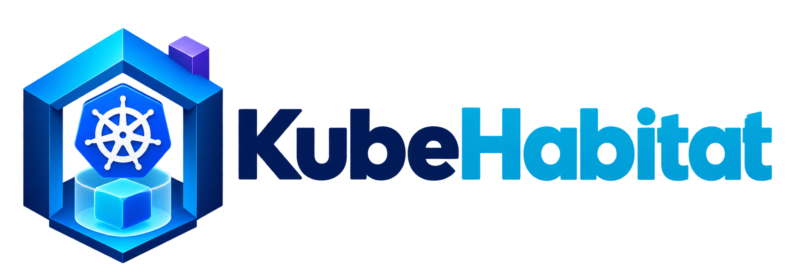
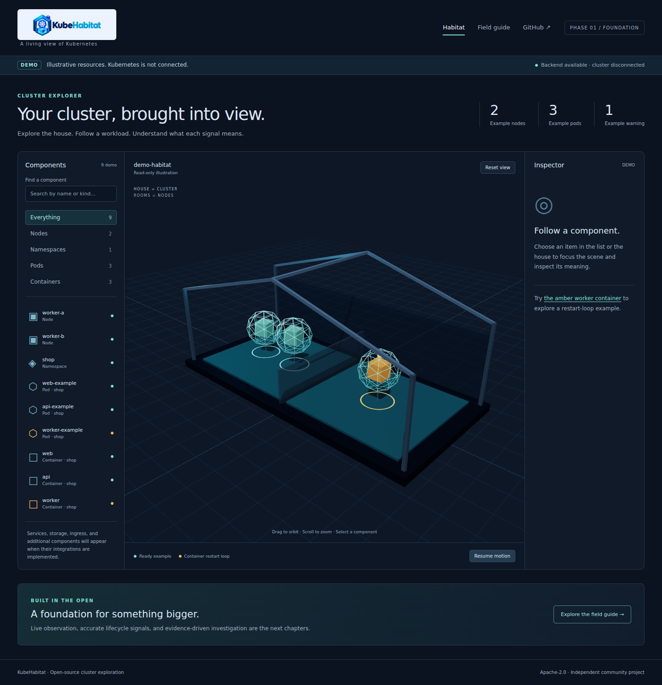
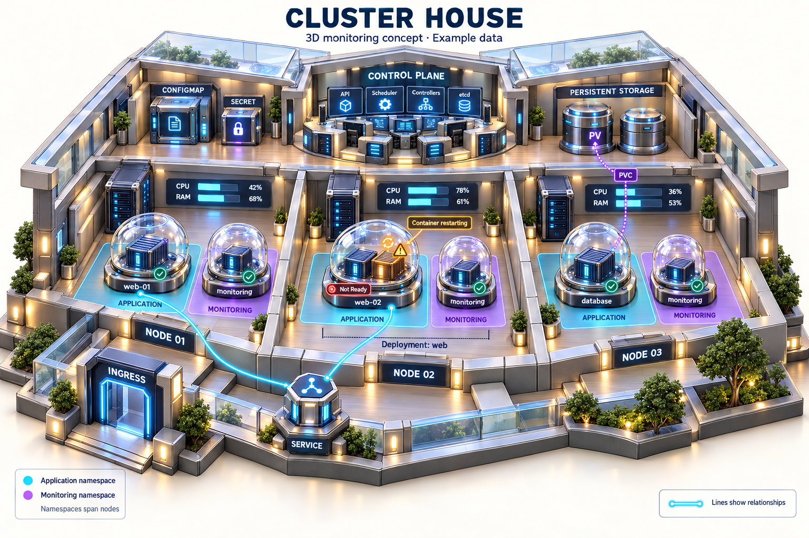
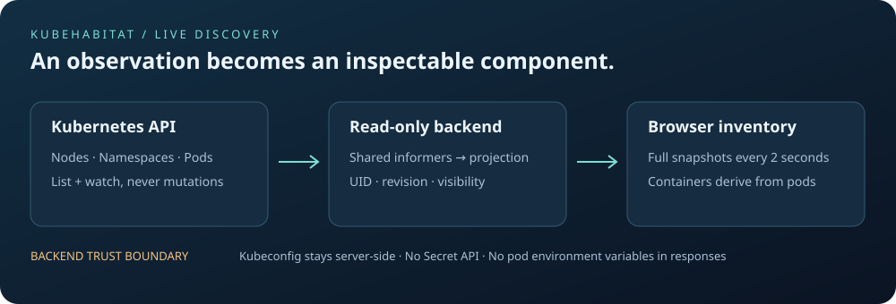
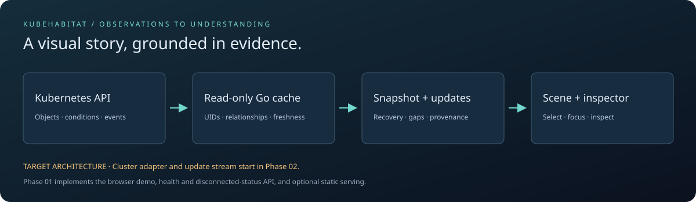
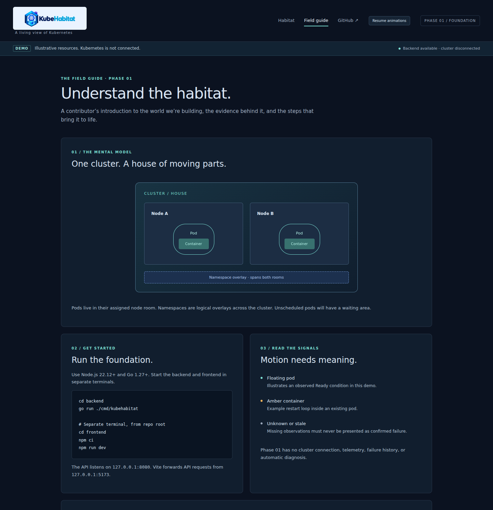

<p align="center"></p>

<h1 align="center">Bring your Kubernetes cluster into view.</h1>

<p align="center">A living, interactive 3D habitat for understanding Kubernetes workloads and their relationships.</p>

<p align="center">
  <a href="LICENSE"></a>
  
  <a href="CONTRIBUTING.md"></a>
</p>

<p align="center"><a href="#get-started">Get started</a> · <a href="docs/architecture.md">Architecture</a> · <a href="docs/roadmap.md">Roadmap</a> · <a href="CONTRIBUTING.md">Contribute</a></p>



_Screenshot of the implemented Phase 01 foundation. All displayed resources are authored demo data._

<details>
<summary>View the full-product visual concept</summary>



Concept art for the intended product; additional pictured integrations are planned.

</details>

## See the system. Understand the signals.

KubeHabitat is an open-source, self-hosted web application in development. Its goal is to make
Kubernetes relationships and observed workload states easier to explore through a navigable 3D
environment.

A **house represents the cluster**, **rooms represent nodes**, and **pods contain visible
containers**. A searchable inventory and a details panel keep the spatial experience grounded in
information an engineer can inspect.

| Visual language               | Kubernetes meaning                                            |
| ----------------------------- | ------------------------------------------------------------- |
| House                         | Cluster                                                       |
| Room                          | Node hosting assigned pods                                    |
| Namespace overlay             | Logical grouping that can span node rooms                     |
| Floating pod with inner boxes | Pod and its containers; motion illustrates observed readiness |
| Amber inner box               | Container issue, distinct from pod replacement                |
| Guided focus                  | Selection links the inventory, scene, and inspector           |

Read the [product specification](docs/product-spec.md) for lifecycle rules, evidence requirements,
and the limits of the metaphor.

## Current status

**Phase 02 — live discovery implemented, real-cluster verification pending.** The Live cluster tab
connects to opt-in read-only Kubernetes discovery. The Habitat tab remains the authored 3D demo;
Phase 03 will generate the house from live objects. Metrics, logs and incident diagnosis are
planned.

Available in this branch:

- React / TypeScript interface with a real Three.js scene, two example node rooms, three example
  pods, and their containers.
- Searchable inventory, resource-kind highlighting, clickable objects, and guided camera focus.
- A details panel explaining each demo resource and its visual meaning.
- Pause controls, reduced-motion support, and HTML inspection when the scene is unavailable.
- An animated field guide with the mental model, setup instructions, target architecture, and
  roadmap.
- Go health/status and live snapshot endpoints; optional serving of the compiled frontend.
- Read-only shared informers for nodes, namespaces and pods, with derived containers.
- A live inventory and condition inspector with per-kind permissions, freshness and recovery.
- Contributor guides and automated build, API, browser, and documentation checks.

See the [live connection guide](docs/live-connection.md) and
[Phase 02 delivery record](docs/phase-02-delivery.md). Real-cluster 3D generation, lifecycle
visualization, investigation, metrics, storage, traffic and packaging follow the
[roadmap](docs/roadmap.md).



## Get started

### Prerequisites

- **Node.js 22.12+** and npm. The development version is recorded in [.node-version](.node-version).
- **Go 1.27+**, installed from [go.dev](https://go.dev/doc/install).
- A WebGL-capable browser for the scene. The inventory and inspector provide a text alternative.
- Git. A Kubernetes cluster is **not required** for the demo; live discovery requires a read-only
  context.

### Development

```bash
git clone https://github.com/Rano1000/KubeHabitat.git
cd KubeHabitat
```

Development happens directly on `main` until the first public release. Pull requests will open after
release; see the [contributor guide](CONTRIBUTING.md).

Start the backend:

```bash
cd backend
go run ./cmd/kubehabitat
```

In a second terminal, from the repository root:

```bash
cd frontend
npm ci
npm run dev
```

Open **[http://127.0.0.1:5173](http://127.0.0.1:5173)**. Select a component, switch resource kinds,
orbit the house, and open the **Field guide** tab.

The UI always labels its local fixtures as **DEMO**. The backend indicator reports API reachability;
backend availability does not mean Kubernetes is connected. Vite forwards `/api` and `/healthz` to
`127.0.0.1:8080`.

### Build and serve with Go

From the repository root:

```bash
cd frontend
npm ci
npm run build
cd ../backend
go run ./cmd/kubehabitat -static-dir ../frontend/dist
```

Open **[http://127.0.0.1:8080](http://127.0.0.1:8080)** for the compiled app and API on one origin.
The foundation binds to loopback by default. Production deployment and authentication are scheduled
for Phase 09.

### Verify the API

```bash
curl http://127.0.0.1:8080/healthz
curl http://127.0.0.1:8080/api/v1/status
```

The status response explicitly includes:

```json
{
  "service": "kubehabitat",
  "version": "0.1.0",
  "connection": "disconnected",
  "dataSource": "demo",
  "message": "Phase 01 foundation. No Kubernetes client is configured. Resources are local demo fixtures."
}
```

## Architecture at a glance



_Target data flow. The cluster adapter and update stream are planned; the current Go API supplies
health and status only._

| Area                | Location                                             | Phase 01 responsibility                               |
| ------------------- | ---------------------------------------------------- | ----------------------------------------------------- |
| Browser application | [frontend/](frontend/)                               | Inventory, demo scene, inspector, field guide         |
| HTTP service        | [backend/](backend/)                                 | Health, disconnected status, static frontend          |
| Project knowledge   | [docs/](docs/)                                       | Product model, architecture, roadmap, onboarding      |
| Quality checks      | [.github/workflows/ci.yml](.github/workflows/ci.yml) | Build, API tests, browser checks, documentation links |

Kubernetes credentials will stay on the backend. Future integrations use read-only access and
preserve object UIDs, observation freshness, and telemetry provenance. See the
[architecture](docs/architecture.md) and [foundation decision](docs/decisions/0001-foundation.md).

## Documentation and contribution

The **Field guide** inside the app introduces the visual model with clean animation and
reduced-motion support. Written guides provide reproducible commands and decisions:

- [Product specification](docs/product-spec.md) — visual meanings and evidence requirements.
- [Architecture](docs/architecture.md) — current service contract and target system.
- [Roadmap](docs/roadmap.md) — phases, acceptance criteria, and verification requirements.
- [Development guide](docs/development.md) — setup, checks, and troubleshooting.
- [Contributor guide](CONTRIBUTING.md) — how to deliver a focused change.
- [Code of conduct](CODE_OF_CONDUCT.md) and [security reporting](SECURITY.md).

<details>
<summary>Preview the interactive field guide</summary>



Open the Field guide tab locally to explore its animated diagrams. System reduced-motion settings
are respected.

</details>

See the [Phase 01 delivery record](docs/phase-01-delivery.md) for verification evidence and
limitations.

Contributions in engineering, Kubernetes modeling, documentation, accessibility, and visual design
are welcome. Discuss significant behavior or architecture changes in an issue before implementing
them. Keep examples visibly distinct from real observations.

## License and identity

Source code is licensed under [Apache-2.0](LICENSE). Project illustrations and the approved first
logo are documented in [asset attribution](docs/assets/ATTRIBUTION.md).

KubeHabitat is an independent community project. Third-party names and marks belong to their owners;
inclusion does not imply endorsement.
