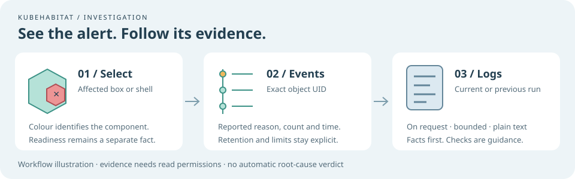

# Investigate a component



Select a component in the scene or inventory, then open **Investigate component**. This performs an
on-demand Kubernetes read, separate from snapshot polling. **Refresh events** retrieves another
evidence snapshot with its own time. Scene readiness and alert colours retain their own meanings.

For a direct pod workflow, use the [pod actions menu](pod-actions.md): right-click a pod or choose
**Pod actions** in its inspector to open details, container logs, events and troubleshooting checks.

## Reported events

Events are matched using `involvedObject.uid`, then verified against the requested UID and
namespace. Container and volume selections use their parent pod UID; the reported field path
identifies a container when available. Other observed objects use their own UID. The panel shows
reported reason, message, count, reporter and last-observed time. These are reported facts, not a
root-cause verdict.

Up to 30 events from the first 100 returned records are shown, sorted by reported time. That API
page may not contain the newest events across every page. A limit note warns when more records may
exist. No retained events does not prove there was no earlier issue. Retention is controlled by
Kubernetes.

For pods, the current UID is checked. Retained events for the selected old UID may remain available
after deletion or replacement, but replacement logs are withheld. API failures show denied, missing
or unavailable categories rather than raw errors.

## Container logs

Select a specific container and choose **Load current logs** or **Load previous logs**. Backend log
access requires `-allow-logs` and Kubernetes `get` permission on `pods/log`.

Reads request timestamps, at most 200 tail lines from the last 15 minutes, and 64 KiB. A backend
byte cap, ten-second deadline and four-request concurrency limit also apply. Reads do not follow a
stream, automatically poll logs or retain incident history. A capped final line may be incomplete.
Empty output only means no lines were returned within this bounded window.

The pod UID is checked before and after the name-addressed log request; a mismatch discards its
body. The log API has no atomic UID precondition, so these checks do not make inventory and logs
atomic. Container runs can restart during retrieval. Previous logs can rotate away, and deleted pod
logs may be unavailable. Missing evidence is explicit.

A known un-timestamped kubelet runtime failure body is also classified as unavailable, even if the
log endpoint returns HTTP success. Timestamped application lines with similar wording are preserved.
This recognizes one specific response shape, not every possible runtime error.

Logs and event messages may contain sensitive values and are not automatically redacted. Intentional
evidence reads are rendered as plain text, strip terminal controls, return
`Cache-Control: no-store`, and are not persisted by KubeHabitat. Keep the unauthenticated preview on
localhost.

## Enable permissions

The base observer RBAC remains unchanged. The optional
[investigation Role](../deploy/rbac-investigation.yaml) grants only `list events` and `get pods/log`
in `habitat-lab`. Adapt its namespace and subject for your installation. Cluster-scoped objects need
appropriate event-list access; otherwise the panel shows denied.

```bash
kubectl apply -f deploy/rbac-investigation.yaml
cd backend
go run ./cmd/kubehabitat -live -context YOUR_READ_ONLY_CONTEXT -allow-logs -static-dir ../frontend/dist
```

Suggested checks are guidance. BackOff describes retries; OOMKilled does not establish a memory
leak. See the upstream [Pod API](https://kubernetes.io/docs/reference/kubernetes-api/core/pod-v1/)
and [logging architecture](https://kubernetes.io/docs/concepts/cluster-administration/logging/).

## Test lifecycle and investigation together

Use only the owned [local test lab](local-test-cluster.md). The helper creates five deliberate
fault/completion scenarios in `habitat-investigation`, plus namespaced evidence permissions there
and in `habitat-lab`. Existing application workloads are not changed.

```bash
# Repository root. Pass --state-dir PATH if the local lab state is elsewhere.
node scripts/investigation-lab.mjs prepare
# Start the updated backend with the lab observer, -live and -allow-logs.
node scripts/investigation-lab.mjs check --port 19096
node scripts/investigation-lab.mjs recover
# Allow ConfigMap propagation and restart backoff, then check again.
node scripts/investigation-lab.mjs check --port 19096
```

Local reports contain assertions, timestamps and pod UID, with no event messages or log bodies.
Recovery accepts explicitly unavailable previous logs only when a prior fault report verified those
logs for the same pod UID. It still requires current recovery logs and historical exit 42.
Re-running prepare resets the recovery gate to the fault scenario. To remove the deliberate
workloads, verify the namespace ownership label is `kubehabitat-test-lab`, then delete only
`habitat-investigation`. The separate optional Role in `habitat-lab` remains installed.

See the [Phase 05 delivery record](phase-05-delivery.md) for verification and remaining limits.
