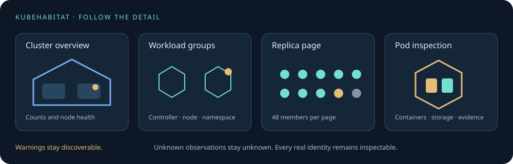

# Explore larger habitats



KubeHabitat now separates the observed inventory from the amount of detail drawn in the house. Above
80 pods, the scene automatically switches to workload groups. Small clusters keep their individual
pods and Service guides. **Scene detail → Grouped workloads** enables the same exploration in the
local lab.

## Navigate from summary to evidence

1. Choose a namespace or an **Application view** based on explicit `app.kubernetes.io/name` / `app`
   labels and, when present, `app.kubernetes.io/instance`. Referenced Services and storage remain
   available as dependencies. This is label-based navigation, not a claim that every application
   dependency has been discovered.
2. Open **Workload groups**. Each group stays within its actual namespace and assigned node.
   Controller groups use the observed controlling owner UID and show its real kind and name;
   ReplicaSets are not renamed into inferred Deployments. Without owner metadata, explicitly
   labelled pods can form **application label groups**; unlabelled standalone pods remain separate.
3. Read ready, investigation, unknown and completed counts. A container warning contributes to its
   pod's investigation count. Stale observations become unknown; successful completion is not a
   crash.
4. Click a group to reveal up to **48 real pods per page**. The remainder stays represented by a
   labelled aggregate. Every page and individual pod remains accessible from the inspector.
5. Use **Needs investigation / unknown** and **Investigate …** shortcuts to reach affected pods.
   Selecting a specific pod draws that real pod and its containers, with existing storage
   inspection.
6. Zoom close to a collapsed group for a preview of up to 24 pod markers. Click a marker to inspect
   its real identity; open the group to browse all members.

Search accepts names, node names and explicit `key=value` labels. The component inventory uses pages
of 60 entries; the workload list uses pages of eight. Breadcrumbs return to the cluster. **Node
map** lists clickable rooms and their warning/unknown counts, with pages of 64 nodes. **Save view**
stores scope and display settings in this browser for this cluster; it does not store credentials or
shared team settings.

## Keep the scene calm

Use **Expand monitoring** above the house to give the live scene the full window. When supported,
the browser also enters true full screen. If an embedded browser does not allow full screen, the
expanded window remains usable. Connection freshness, scoped component counts and the health legend
stay visible. **Components** opens the existing filters and inventory; selecting a real object opens
**Details** with its existing evidence and attachments. These panels can be closed to reclaim the
scene. **Scene options** exposes grouping and visual layers when needed.

**Exit monitoring** or **Escape** returns to the original page and keyboard focus. Namespace,
application, selection and motion settings stay intact, and the same live scene keeps running.
Expansion does not reconnect to Kubernetes or change any workload. Measured usage still requires the
Metrics API; enlarging the display does not invent missing measurements.

Group geometry is instanced, and detailed container geometry is mounted only for revealed pods.
Service links appear around the selected resource. Multiple real endpoints mapped to the same group
anchor share one visual link; exact endpoint identities remain in the inspector. More than 32
Services use compact figures until a Service is selected for its full walking guide. Node and group
summaries preserve investigation counts even when individual geometry is hidden.

Group placement is deterministic under snapshot reordering and replica replacement within the same
owner/node group. Camera framing changes on deliberate navigation and viewport resizing, rather than
resetting on every snapshot. Opening pages or adding/removing workload groups can change room
geometry; persistent spatial reservations across structural changes remain future work.

**Observed activity** records the last 20 pod state/inventory changes seen in this browser session.
Initial connection, observer restart and reconnect gaps do not fabricate events. An object leaving
the inventory does not imply a crash or a confirmed replacement. This is not durable incident
replay.

## Transport and validation

The backend keeps its read-only shared Kubernetes informers. Conditional snapshot requests use
ETags: unchanged observations return a body-free 304 heartbeat; changed API visibility, expired
usage samples and new sessions replace the snapshot. This reduces unchanged inventory downloads.
Changed snapshots still send the full inventory; server-side scoped subscriptions and delta delivery
remain future scale work.

Run:

```sh
cd frontend
npm run test:layout
npm run benchmark:scale
npm run build
npm run test:e2e
```

The synthetic model benchmark covers 100, 1,000 and 5,000 pods, with two containers per pod. It
checks exact counts and the bounded expansion. Its first local run measured median layout/summary
times of approximately 2 ms, 15 ms and 77 ms. The 5,000-pod dataset produced 50 node rooms and 100
groups. These are CPU model measurements, not browser frame rates, memory limits or production
certification. Browser integration tests cover large snapshots, investigation navigation, replica
pagination and conditional-request freshness. Real production scale and durable history remain
acceptance work.

To enable observed controller references and conditional requests in an existing installation,
restart with the new backend build. An older backend still works with labelled/standalone grouping
and ordinary full snapshots.

## Local review on 2026-10-11

All 30 layout/policy/scale tests pass. Go tests, vet and the Windows backend build pass. Manual
browser review confirmed application scoping, group-to-pod navigation and three-container/storage
inspection against the existing lab observer's retained observations. The expired observer correctly
produced unknown health instead of ready counts. Fresh controller metadata requires the updated
backend.

The two new automated browser tests could not run locally: the sandbox browser cache was missing,
and installing Chrome into the workspace failed with Windows `EPERM` during extraction. Their local
result remains unverified; CI installs its browser before running the suite. Synthetic model timings
do not establish production readiness or browser rendering performance.
