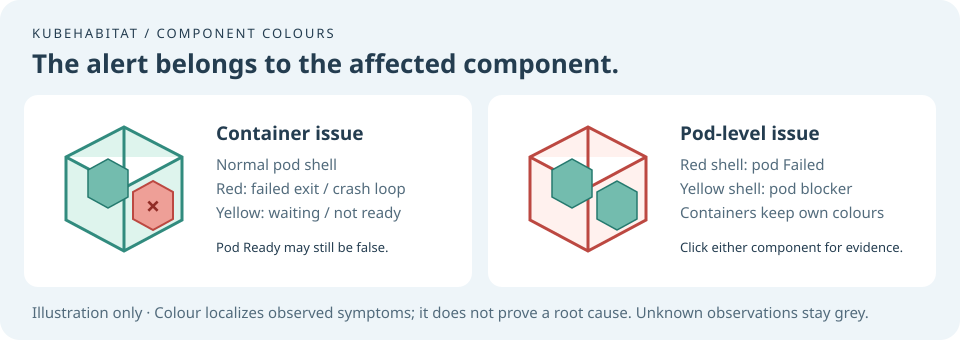

# Workload lifecycle and evidence

Open a pod or container in the live inspector. **Lifecycle evidence** explains the observed signal,
names the Kubernetes status source, and shows the observation time. Container details separate the
current run from the previous termination. A ready container can still have an earlier `OOMKilled`
exit; that historical fact does not make its current state failed.

| Signal              | Visual behaviour                                        | Evidence required                                         |
| ------------------- | ------------------------------------------------------- | --------------------------------------------------------- |
| Ready               | Pod floats and rotates                                  | Fresh Pod Ready observation                               |
| Waiting / not ready | Stationary; affected component amber; `…` or `!` marker | Waiting state or false readiness                          |
| Completed           | Stationary, blue; `✓` marker                            | Pod Succeeded or container exit code 0                    |
| Failed              | Red `×`; failed pod has floor fragments                 | Pod Failed or nonzero container exit code                 |
| Deletion requested  | Stationary `↓` marker                                   | Deletion timestamp / Terminating state                    |
| Unknown             | Stationary `?` marker                                   | Missing status, incomplete sync or unavailable visibility |

Floor fragments belong to a **currently observed failed pod**, not a disappeared object or a
container restart. Container symbols remain independently selectable inside the pod. Theme forms and
uniforms remain unchanged; each theme uses its own existing health palette. Pause and reduced motion
keep the same evidence and symbols visible.

## Pod shell and container alerts

Container colours are independent. A failed exit or active `CrashLoopBackOff` is red; other waiting
states and false container readiness are yellow. A recovered container keeps its normal colour, even
if Kubernetes retains a previous failed exit. A failed pod does not automatically recolour its
containers.

When Kubernetes reports `ContainersNotReady`, and a fresh child container has a current issue, the
shell stays normal unless independent pod-level evidence is present. The same applies to an observed
init-container issue with `ContainersNotInitialized`. Scheduling, sandbox startup, independent
readiness gates and Pod status reasons retain the shell's warning. A Failed pod has a red shell.
Missing or stale child evidence cannot clear a pod warning.

**Normal shell colour describes the component carrying the alert; it does not mean Pod Ready is
true.** Readiness stays unchanged in the inspector, unhealthy children remain in investigation
counts, and Pod Ready=false pauses floating motion. Unknown observations stay grey.

## Read a restart correctly

The restart count belongs to the container within its parent pod UID. Only a positive count change
between two visible, synchronized snapshots produces a browser activity entry. Initial connection
does not invent historical restart events. Decreasing counts are labelled a status discontinuity.
New pod UIDs appear as new inventory identities; KubeHabitat does not guess which departed pod they
replace from names or simultaneous observations.

The activity list retains the most recent 20 changes in the current browser session, including
container states, readiness, reported reasons, restarts, pod appearances and departures. It keeps
previous entries through connection gaps and suppresses comparisons across those gaps. Refreshing
the page or restarting the observer clears it. Snapshot time records when a change was seen, not
when it necessarily happened. Durable incident history and replay remain planned.

## Facts and suggested checks

`CrashLoopBackOff` describes delayed retries, not a root cause. `OOMKilled` is a reported
termination reason; it does not prove a memory leak. Suggested next checks are clearly labelled
guidance. Events and optional logs are available in the [investigation panel](investigation.md).
Kubernetes status can omit previous termination details; the UI says so instead of manufacturing
them.

The API projects only termination reason, exit code, and reported start/finish timestamps. It does
not expose termination messages, runtime container IDs, Pod status messages or environment values.
See the upstream
[Kubernetes pod lifecycle documentation](https://kubernetes.io/docs/concepts/workloads/pods/pod-lifecycle/)
for the underlying state and identity model.

## Validation limits

Unit fixtures verify completed tasks, unsuccessful exits, recovered containers, unknown freshness,
deletion, identity changes and reconnect gaps. Live cluster acceptance should also demonstrate a
restart, a completed task and a failed pod. Historical failure markers and confirmed controller
replacement timelines require recorded evidence and are still open. See the
[Phase 04 delivery record](phase-04-delivery.md).
