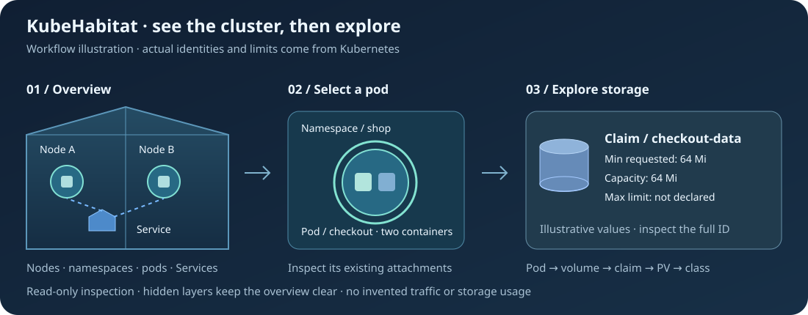
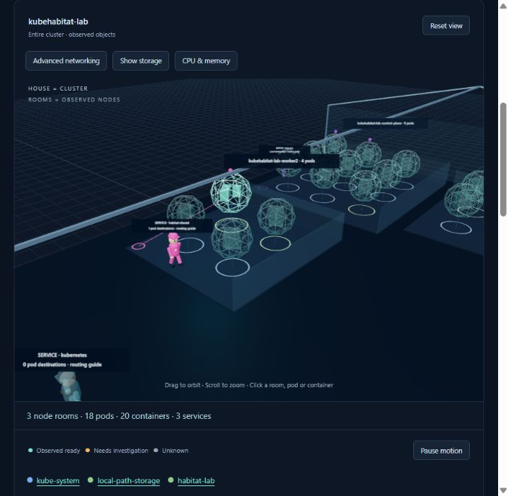

# Explore live topology

Habitat generates its geometry from observed objects. Select a namespace, search an object, or use
the kind filters to guide the camera. Each pod contains its observed app, init and ephemeral
containers. Node assignment determines its room. Pods without an observed node enter a waiting area.
Removing an object removes its identity; it does not invent a crash history.

## Start simple, explore on request

The default house shows nodes, namespace boundaries, pods and Services. Each Service is a labelled
human routing guide with its configured pod destinations. One guide patrols the rooms containing its
observed endpoint pods, including multiple node rooms when necessary. A Service without observed pod
destinations stays at its marker. The walking is ambient illustration, not traffic telemetry,
readiness or security enforcement. It pauses with the motion control, system reduced motion or stale
Service/endpoint discovery. Clicking the figure opens its Service inspector. EndpointSlices supply
those relationships in the background; they do not need to occupy the default scene. Advanced
networking, storage and resource layers start hidden. Hiding a layer changes presentation, not
discovery or the observed inventory.

Uniform colour identifies the Service using its namespace and name. The same colour appears on its
route links and small badges above its observed destination pods. Multiple Services targeting one
pod produce multiple badges. Colours remain consistent across namespace filters, snapshot ordering
and pod replacement. A clickable **Service uniforms** legend and each pod's **Services serving this
pod** section expose the relationship by name as well as colour. Pod health colours and namespace
floor rings retain their independent meanings; a stale Service keeps its colour with reduced
opacity.

1. Select a namespace to scope its pods and Services across their real node assignments.
2. Select a pod to inspect its containers and existing volume attachments.
3. Choose **Explore this pod’s storage** to reveal that pod’s volumes, claims, bound PVs and
   classes.
4. Select an attachment or claim to inspect its identity and configuration. **Show all pod storage**
   restores the storage layer for the current namespace scope; **Reset view** restores the overview.

The component list, name search and guided camera provide direct navigation. **More components**
contains the advanced kinds; the networking layer exposes ingress, EndpointSlices and policy checks.
Ingress describes incoming routing to Services; EndpointSlices describe backend destinations. None
of these references proves traffic or a successful application response.

Storage labels show **Min requested**, **Capacity**, **Max limit** and an abbreviated identity; the
inspector exposes the full identity. Min requested is a PVC allocation request, not a minimum usage
measurement. Capacity is observed provisioned size, not an inferred maximum. Max limit appears only
where an explicit volume size limit exists. Missing configuration is **Not declared**; a claim that
has not been observed is **Not observed**. StorageClasses do not define a universal volume minimum
or maximum, and namespace quotas show their declared storage accounting limit separately.

Replicas may inherit the same pod template but need not use the same persistent volume. A shared
claim can be referenced by several pods; StatefulSet volume claim templates can create a separate
claim for each pod. Inspect the actual attachment rather than assuming shared storage. See the
[persistent volume model](https://kubernetes.io/docs/concepts/storage/persistent-volumes/) and
[StatefulSet storage behavior](https://kubernetes.io/docs/concepts/workloads/controllers/statefulset/).
Selection is read-only: it never changes a mount, claim, pod or cluster configuration.

The screenshot above is the implemented live lab view with the shared Service selected. The figure
is an interaction metaphor for routing, not an extra Kubernetes workload or a node security agent.

## Coverage

| Layer             | Visible objects and evidence                                                                                         | Limits                                                                     |
| ----------------- | -------------------------------------------------------------------------------------------------------------------- | -------------------------------------------------------------------------- |
| Workloads         | Nodes, namespaces, pods, all declared containers                                                                     | Controllers and arbitrary custom resources are not yet projected           |
| Networking        | Services, EndpointSlices, ingress, NetworkPolicy                                                                     | Configured references; no traffic telemetry or active reachability probes  |
| Pod storage       | Declared volumes, container mount references, memory-backed emptyDir size limits                                     | Secret and ConfigMap payloads and source references remain hidden          |
| Namespace storage | PersistentVolumeClaims, requested size and observed binding                                                          | A namespace groups claims; it is not a separate physical disk              |
| Cluster storage   | PersistentVolumes and StorageClasses, capacity and reclaim/binding information                                       | No provider credentials, CSI handles, host paths or filesystem consumption |
| Resources         | Node CPU, memory and ephemeral storage capacity/allocatable; container requests and limits; ResourceQuota accounting | Quota `used` means API accounting, not measured RAM or filesystem usage    |
| Measured usage    | Optional Metrics API node, pod and container CPU/memory samples, timestamp and window                                | No provider means unknown; samples older than 90 seconds are omitted       |

CPU and memory are different from persistent disk. Memory-backed `emptyDir` uses RAM; disk-backed
`emptyDir` uses node storage. PVCs are namespace objects and PVs are cluster objects. StorageClass
describes provisioning. These relationships follow the
[Kubernetes volume model](https://kubernetes.io/docs/concepts/storage/volumes/).

## Network signals

Service-coloured connectors show their configured pod destinations. Blue connectors show other
observed network references: ingress to service, service to EndpointSlice targets, and the slice's
pod identities. They do not animate as traffic. Endpoint readiness is available in the inspector; it
does not certify application responses.

The **Pod → pod policy check** evaluates a direction, destination port and protocol. Source egress
and destination ingress must both permit the declared connection. Rules across policies are
additive. Label selectors, namespace/pod selector combinations, numeric port ranges and observed
named destination ports are supported.

- **Allowed by policy:** declarations permit the selected connection.
- **Denied by policy:** a selecting policy excludes the connection.
- **Unknown:** stale/denied discovery, an IPBlock or unavailable named-port information prevents a
  supported decision.

None of these labels claims measured reachability. CNI enforcement, other firewall layers, routing,
listeners, NAT and existing-connection behavior require separate evidence. See the
[Kubernetes NetworkPolicy semantics](https://kubernetes.io/docs/concepts/services-networking/network-policies/).
The default kind CNI in this lab is not asserted to enforce NetworkPolicy.

## Resources and freshness

The optional adapter polls `metrics.k8s.io/v1beta1` every 15 seconds. CPU is displayed in millicores
and memory in MiB. Memory means the reported working set. Samples attach to observed identities;
replacement UIDs do not inherit old samples. Failed requests remove current usage claims. See the
[resource metrics pipeline](https://kubernetes.io/docs/tasks/debug/debug-cluster/resource-metrics-pipeline/).

The lab does not install metrics-server. Its Metrics API is unavailable until a working provider is
configured. Requests, limits and capacities remain inspectable. Kind nodes share host resources;
their reported capacities should not be added into a physical-machine RAM total.

## A real multi-container example

[The topology fixture](../deploy/local-test/topology.yaml) creates `habitat-shared`: one pod with
`application`, `logger-sidecar` and `cache-sidecar`. Two containers mount the same PVC-backed
volume; two mount a memory-backed emptyDir. The scene draws three inner boxes and two volume
cylinders, with references to the claim, bound PV and storage class.

The lab also creates a service, an ingress policy, allowed/restricted client pods and a namespace
quota. Pause images declare a test port but do not listen or generate traffic. This tests observed
configuration, not a successful HTTP connection. Keep fixtures in the isolated `habitat-lab`
namespace; use explicit lab kubeconfig and context for administrative commands.
