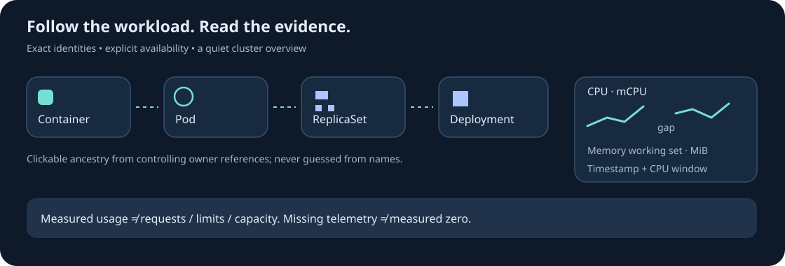

# Metrics and workload ownership

Open a node, pod or container's inspector to see CPU in **mCPU** and memory working set in **MiB**.
Each measurement includes its Metrics API timestamp and CPU averaging window. Memory is the reported
working set, not disk usage. CPU requests, memory requests, limits and node capacity remain separate
configuration values. Consumption is not a readiness signal.

## Short live trends

The inspector collects up to five minutes of samples while it stays open, with a maximum of 40
points. Repeated timestamps do not add duplicate points. Missing telemetry and intervals longer than
45 seconds break the line. Hover a point for its measurement and timestamp. Changing the selected
object or restarting the backend resets this inspector history. This is not durable incident replay.

The Metrics API is optional. A missing provider, rejected credentials or denied access means
**unknown usage**, never zero. Samples older than 90 seconds, more than five seconds in the future,
without both CPU and memory, with negative quantities or invalid averaging windows are excluded.
Samples cannot predate an observed resource's creation or transfer to a replacement UID. A pod's
aggregate is withheld when required container samples are missing; valid individual container
samples remain inspectable.

No kubelet proxy permission or TLS verification bypass is required by KubeHabitat. Configure a
working Metrics API provider independently; this milestone does not install one into your cluster.

## Follow the controlling owner

The inventory includes Deployments, ReplicaSets, StatefulSets, DaemonSets, Jobs and CronJobs. They
stay out of the default 3D overview to keep pods, nodes and Services easy to see. Use the component
list or search to inspect them.

A container can lead to its pod, then its observed controlling ReplicaSet, then its Deployment. A
Job can lead to its CronJob. Each available ancestor is clickable. Resolution uses the exact UID,
kind and namespace; it never guesses a Deployment from a pod name. Missing owners remain visible as
references with “not observed.” Cached ancestry is labelled when freshness is unknown. Application
scope retains unlabelled controlling owners as dependencies.

Controller status includes observed generation and replica counts where available. An older observed
generation is reconciling, zero desired replicas are scaled to zero, completed Jobs are completed,
and failed Job attempts alone do not mean the Job has finally failed. These summaries do not replace
inspection of controller conditions or rollout strategy.

## Permissions and connection renewal

Apply the updated [read-only role](../deploy/rbac-readonly.yaml) through your normal cluster
administration process. The new `apps` and `batch` permissions are only `get`, `list` and `watch`.
The role does not allow workload mutations or Secret reads. [Log and event access](investigation.md)
remains separately configured.

Informers preserve client-go's randomized watch timeout instead of forcing 30-second watch cycles.
LIST calls and verification probes have bounded contexts; watch streams do not use a blanket
40-second HTTP timeout. Explicitly stopped watches do not report outages, late callbacks from a
superseded watch are ignored, and unexpected closure or API status errors remain visible. Successful
LIST probes cannot hide failed WATCH permissions. Credential rejection is distinct from forbidden
read access. The development lab's observer token expires after one hour and needs renewal.

See the [Phase 06 delivery record](phase-06-delivery.md) for verification and remaining work.
