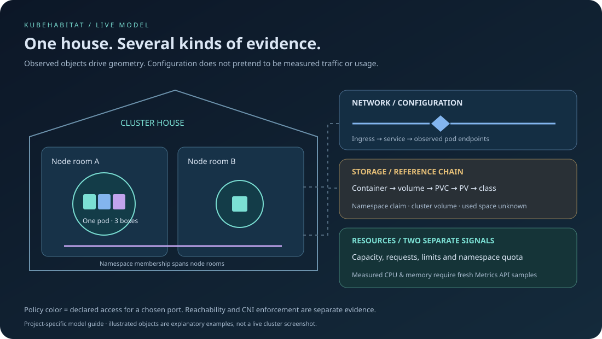

# Phase 03 delivery record

## Implemented

- Habitat and Live cluster share real snapshot data; authored fixtures require `/#demo`.
- Deterministic node rooms, assigned pods and every app/init/ephemeral container.
- House and room dimensions grow and shrink with observed placement. Unscheduled pods have a waiting
  area; missing nodes never manufacture rooms.
- Namespace overlays, kind highlighting, selection, inspector and guided camera focus.
- Readiness motion requires fresh Pod Ready evidence; pause and system reduced motion are respected.
- Initial live network/storage/resource layers requested alongside the house correction. See the
  [coverage guide](live-topology.md) for supported resources and evidence boundaries.
- Real isolated fixtures: three-container pod, shared PVC and memory-backed volume, service,
  endpoint slice, policy, client pods and namespace quota.

## Verification on 2026-10-10

| Check                            | Evidence                                                                                                                                             |
| -------------------------------- | ---------------------------------------------------------------------------------------------------------------------------------------------------- |
| Original live house              | In-app browser verified 3 node rooms, 15 pods and 15 containers from the lab                                                                         |
| Namespace scope                  | `habitat-lab` correctly showed all 3 node rooms and its 2 pods/containers before adding topology fixtures                                            |
| Real scale change                | Deployment scaled 2 → 8 → 2; the scene showed 8 pods and house depth expanded from 11 to 17.74 layout units, with unscheduled pods in a waiting area |
| Multi-container/storage fixtures | Kubernetes reported `habitat-shared` 3/3 Running, a Bound 64 Mi PVC, service and policy objects                                                      |
| Model and policy checks          | 17 Node test cases pass, covering identity, count, placement, growth/contraction, cross-node namespaces and policy semantics                         |
| Backend                          | Go tests including topology projection/redaction and metric units/failure handling pass                                                              |
| Frontend                         | TypeScript check and Vite production build pass                                                                                                      |

The expanded preview at `http://127.0.0.1:19094/#habitat` was reviewed in the in-app browser.
Namespace `habitat-lab` showed 3 observed node rooms, 5 pods and 7 containers. Selecting the shared
pod exposed its three Running containers and both volumes in the inspector. All 11 supported API
kinds reported current observations after a connection interruption. The allowed client returned
“Allowed by policy” for TCP port 80; the restricted client returned “Denied by policy”. When API
observations were stale, the check returned “Unknown”. These are configuration evaluations, not
measured reachability. No browser console errors were observed during this review.

The memory-backed volume inspector showed `emptyDir`, medium `Memory` and a `16Mi` size limit. The
local API connection intermittently reconnects during review; affected resources retain their last
observation with unknown freshness. Investigating that instability remains acceptance work.

The full automated browser suite remains unverified locally; manual checks do not substitute for it.

## Focused overview refinement on 2026-10-11

The default scene now shows nodes, namespaces, pods and labelled Services. Storage, advanced
networking and capacity layers open on request. Namespace selection scopes its workloads and
Services across nodes. Pod inspection lists its containers and existing attachments, and storage
exploration follows only that pod's volume/claim/PV/class chain. Selection remains read-only.

Storage bodies display identities and separate allocation requests, observed capacities and explicit
limits. The inspector distinguishes missing declarations from unobserved claims. StorageClasses and
namespace quotas retain their different meanings. See the animated
[focused exploration guide](assets/focused-exploration.svg).

TypeScript and the production build pass. All 21 layout/policy tests pass, including hidden-layer
geometry, attachment identity, storage semantics and namespace membership. A browser regression
scenario was added for the default overview, namespace selection and pod-specific storage; it is
listed successfully but has not been executed locally because browser launch remains restricted.

Earlier manual review confirmed the core component list and namespace scope, Service destinations,
and the shared pod's three containers, 64 Mi claim and 16 Mi memory-backed volume. The old preview
later retained stale observations after its credential expired. Restarting on port 19094 collided
with an existing process. Fresh preview verification of this refinement remains pending on the
regular-terminal launcher; no current health verdict is inferred from the cached review.

## Human Service guides on 2026-10-11

Services now use clickable human figures with uniforms, labels and walking limbs. One figure per
Service follows a deterministic patrol around rooms containing its observed endpoint pods. Services
without observed pod destinations remain at their markers. Pause, system reduced motion and stale
Service/endpoint discovery stop movement. Blue connectors retain configured references; no packet
rate or security enforcement is invented.

The production build and all 23 layout/policy tests pass. The additional tests cover cross-node
destination membership, unrelated nodes and stale endpoint UIDs. The regular-terminal preview on
port 19095 was reviewed with current observations from all 11 supported APIs. Inventory selection
opened the shared Service inspector with its actual destination and TCP port. Screenshots confirmed
the human figure, changing patrol positions and limb pose, and paused/resumed motion. No error-level
browser logs were returned; the existing Three.js Clock deprecation warning remains.

Clicking the human figure's body in a focused Services view opened the correct Service inspector.
The camera includes the full patrol bounds when focusing a Service, so walking does not leave a
frame centred only on its starting marker. Further keyboard accessibility review remains open. The
full automated browser suite remains locally unverified.

## Further acceptance work

Refine house artwork with the user; verify camera and keyboard navigation across further cluster
sizes; complete denied access/outage/recovery lab scenarios. Later-phase telemetry,
controller/custom-resource coverage and lifecycle history remain open. No production release or
successful GitHub publication is claimed.
