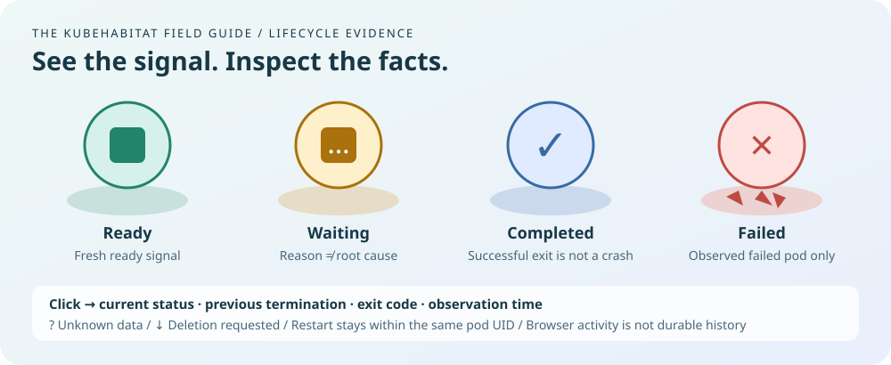

# Phase 04 · Workload lifecycle

Status: **In review**. Initial lifecycle interpretation and inspection are implemented. This is not
a complete incident investigation or replay milestone.

## Delivered

- Distinct ready, waiting, not-ready, failed, completed, deletion and unknown signals.
- Failed-pod floor fragments tied to the current observed failed identity; selectable container
  symbols and selected-pod state labels in all three visual themes.
- Timestamped status evidence with separate current and previous container terminations.
- Restart deltas within the same pod identity, container-state activity, and explicit suppression
  across connection gaps, incomplete synchronization and observer-session changes.
- Suggested next checks labelled guidance, with no inferred crash from disappearance or inferred
  replacement from matching names.
- Independent pod-shell and container alert colours. A fresh child issue attributed by Kubernetes
  readiness or initialization conditions leaves the shell normal unless independent pod evidence is
  present. Actual Pod Ready and investigation counts remain unchanged.

## Validation

The frontend lifecycle tests cover exit code 0 versus unsuccessful termination, historical OOM
versus current readiness, missing exit evidence, deletion, stale health, initial restart counts,
restart deltas, count resets, new pod UIDs, reconnect gaps and malformed status evidence.

Backend tests verify timestamp and reason projection, current/previous separation, deletion
semantics, and redaction of Pod messages, termination messages, environment values and runtime IDs.
Browser integration includes recovered-container inspection followed by a successful termination.

On 2026-10-11, all 37 frontend model tests and four local-lab isolation tests passed, along with
frontend compilation, Go tests/vet/build, documentation links and formatting. The initial Go metrics
test failed while network access was restricted; the suite passed after network access was granted.
Automated browser checks were attempted with installed Edge, but Windows sandbox browser launch
failed before application assertions. Browser assertions are therefore unverified locally. The
existing live lab endpoint was unreachable from the command session; live scenario acceptance is
still pending.

The component-colour follow-up passes all 42 frontend model tests, including crash loops, healthy
siblings, pod scheduling and sandbox blockers, init containers and stale child evidence. Browser
fixtures assert the normal shell and red crash-loop container independently. The running local lab
was subsequently inspected in the app: its recovered application container showed the current Ready
state separately from one recorded restart and an earlier exit code 255 with reason Unknown. This
was followed by the Phase 05 lab: all ten real-cluster fault checks passed, including a healthy
sibling beside a red crash-loop container and distinct scheduling, waiting, Failed and Completed
states. The crashing container subsequently recovered in the same pod UID with its exit-42 history
intact. The follow-up combined lab passed ten fault checks and eleven recovery checks. See the
[combined validation record](phase-05-delivery.md) for the previous-log availability edge case and
verification details.

## Still open

Durable failure markers after removal, confirmed controller replacement sequences, recorded incident
replay remain open. On-demand Events/logs are now implemented and validated in
[Phase 05](phase-05-delivery.md). Floor fragments are a visual sign of an observed Failed pod, not a
retained historical object. A failed container does not break apart its still-existing pod. Read the
[lifecycle guide](lifecycle.md) for limits.
