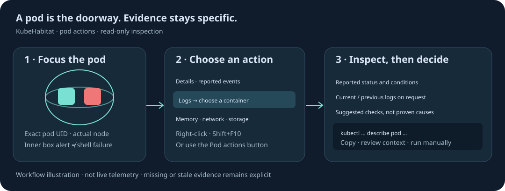

# Inspect from the pod

Open **Pods needing inspection** above the scene and choose **Focus issue** to bring a pod into view
and open its troubleshooting guide. The count follows the current namespace/application scope.
Container issues count even when the pod shell retains its normal colour. Unknown freshness is
included for inspection; completed tasks and recovered termination history are not alarms. The tray
shows ten pods per page.

Right-click a pod in the 3D scene or inventory, press **Shift+F10** on its inventory row, or select
the pod and use **Pod actions** in the details panel. The menu works in expanded and full-screen
monitoring and inherits Midnight, Garden and Blueprint colours. Escape or an outside click closes
it. It disappears if the selected pod identity leaves the cache or the observer session changes.

| Action                | What opens                                                            |
| --------------------- | --------------------------------------------------------------------- |
| Pod details           | Identity, placement, containers and observed relationships            |
| Container logs        | Explicit container selection, then current/previous log controls      |
| Reported events       | An on-demand event read scoped to the selected UID                    |
| Troubleshooting guide | Reported pod/container status, suggested checks and copyable commands |
| CPU & memory          | Resource layer and per-container configuration/available samples      |
| Network relationships | Network layer with this pod as policy source, plus observed Services  |
| Storage attachments   | Storage layer scoped to the selected pod’s existing attachments       |

## Keep evidence separate from interpretation

The guide explains projected Kubernetes status using explicit rules. CrashLoopBackOff describes
container retry behaviour; it does not identify the underlying cause. OOMKilled suggests checking
memory and limits, but does not prove a leak. Image pull failures suggest checking image references,
registry reachability and permissions. Stale status is labelled unknown. The guide does not claim to
diagnose arbitrary log text, infer measured traffic, or prove connectivity from a policy rule.

Opening the menu or choosing a container does not retrieve logs. Choose **Load current logs** or
**Load previous logs** to request the bounded evidence described in the
[investigation guide](investigation.md). App, init and ephemeral containers remain individually
selectable. Missing, denied or rotated evidence stays explicit.

## Commands you control

Suggested commands are read-only and are never executed by the website. Replace `<YOUR_CONTEXT>`
with the intended kubectl context before running one in Bash or PowerShell. Commands use the
selected namespace, pod name and container name. They are name-based CLI reads, so compare the UID
in the inspector with the current pod if a replacement may have occurred. Only valid Kubernetes DNS
names are interpolated; untrusted values do not become shell commands. Clipboard failures leave
selectable command text available.

The memory command needs Metrics Server; network commands inspect declared configuration; storage
commands list namespace claims rather than asserting all claims are attached to this pod. No
restart, deletion, exec, configuration update or Secret read is offered.

The commands follow upstream
[debugging running pods](https://kubernetes.io/docs/tasks/debug/debug-application/debug-running-pod/)
and [kubectl logs](https://kubernetes.io/docs/reference/kubectl/generated/kubectl_logs/) guidance.
