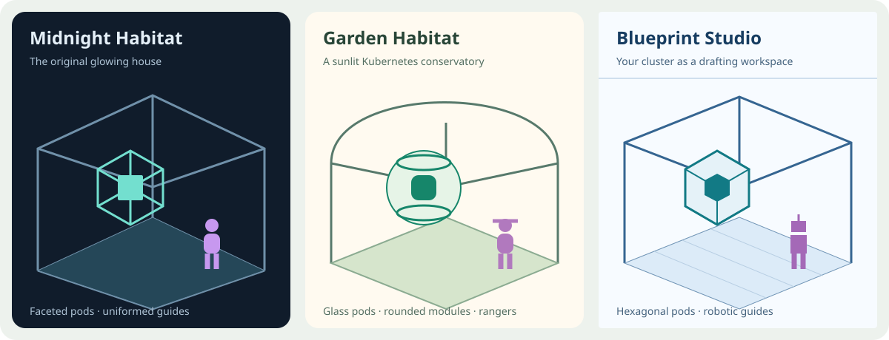
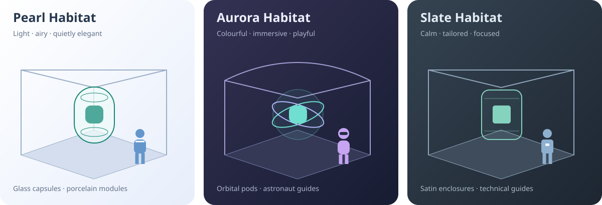

# One cluster. Six habitats.

Choose **Theme** in the header, the dropdown above the house, or **Monitoring theme** while the
scene is expanded. Your choice is remembered in this browser. A new browser starts with the original
Midnight Habitat; blocked browser storage does not prevent switching themes.

| Theme            | Interface                                                                                                    | Cluster and nodes                                          | Pods and containers                                               | Services                                                      |
| ---------------- | ------------------------------------------------------------------------------------------------------------ | ---------------------------------------------------------- | ----------------------------------------------------------------- | ------------------------------------------------------------- |
| Midnight Habitat | Original dark panels, teal accents and familiar navigation                                                   | Gabled frame with dark node rooms                          | Glowing faceted cages and inner boxes                             | Original walking uniformed guides                             |
| Garden Habitat   | Warm ivory, green accents, soft cards and rounded controls                                                   | Arched greenhouse, rounded deck and pale green rooms       | Glass globes with circular collars and rounded inner boxes        | Rangers with wide hats and packs                              |
| Blueprint Studio | Light drafting paper, compact square controls and monospace headings; inventory on the right on wide screens | Modular flat frame and blue drafting grid                  | Hexagonal enclosures and inner six-sided modules                  | Walking robotic guides with block limbs, visors and antennae  |
| Pearl Habitat    | Warm white, quiet blue accents, rounded controls and porcelain panels                                        | Open pavilion with a rounded deck and soft node partitions | Glass capsules with delicate collars and rounded modules          | Minimal human guides with white collars and coloured uniforms |
| Aurora Habitat   | Deep indigo, restrained violet highlights and soft glass-like panels                                         | Luminous atrium with shallow arches                        | Transparent orbs with tilted orbital collars and polished modules | Playful astronaut-style humans with dark visors               |
| Slate Habitat    | Calm charcoal, steel blue accents and understated panels                                                     | Flat campus frame with satin node rooms                    | Rounded rectangular enclosures and lightly bevelled modules       | Tailored technical guides with simple identification badges   |

All original themes remain available. Pearl, Aurora and Slate reduce persistent Service labels:
select a guide to reveal its destination summary. Their slower float, rotation and walking speeds
give each habitat a different feel without adding extra particles or claiming measured traffic.
Motion still requires fresh readiness observations and respects pause and reduced-motion
preferences.

Grouped workload markers, storage and networking objects, resource-list icons and scene labels also
follow the chosen theme. The authored demo uses the same vocabulary but remains clearly labelled as
demo data. The field guide and full-screen observation panels follow the interface palette too.

## Stable meaning while the appearance changes

Switching a theme preserves the current resource selection, namespace, application, grouping, visual
layers and motion preference. It does not reconnect to Kubernetes, alter an API resource, or change
which pod belongs to which node. Health observations keep the same meaning: ready, investigation,
unknown and completed states remain distinct. Stale observations cannot become healthy because a
theme changed. Service uniform identity colours and namespace membership colours remain stable.

The greenhouse, drafting platform, floating pods and walking Service figures are visual metaphors.
Walking still does not claim measured traffic, and capacity is still different from measured usage.
Changing materials or shapes does not provide new telemetry. Red, amber, neutral unknown and
completed-state colours retain their meanings in every palette; decorative violet and blue are not
failure signals. Memory and networking details remain available on request.

## Contributor notes

`frontend/src/themes.tsx` owns the validated theme preference and scene palettes. `themes.css`
defines the interface surfaces and layouts. `ThemeGeometry.tsx` defines the shared cluster frames,
pod shells and rounded geometry. Live and demo scenes consume these styles without replacing their
resource identities or layout models. Canvas labels use sRGB textures without lighting tone mapping
so the text stays legible against the lighter backgrounds. Allocated rounded geometry and label
textures are disposed when replaced.

Keep new geometry inside the existing resource footprint, preserve container hit targets, and keep
theme changes out of camera-focus and live-data dependencies. Honour reduced motion in every theme.
